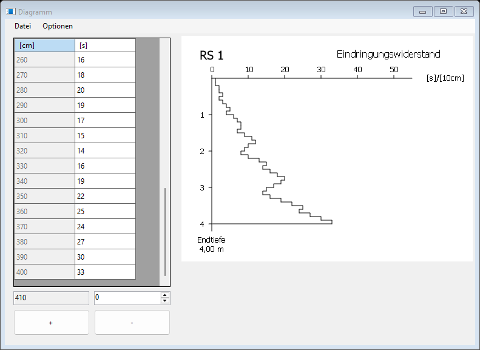

# Rammsonde

[](https://github.com/add-IV/Rammsonde/actions/workflows/build.yml)


A Windows desktop tool for recording and plotting **dynamic probing** data (German: *Rammsondierung*). This is a soil investigation method in geotechnical engineering: a probe is driven into the ground and the time in seconds it takes to advance each 10 cm is recorded as the penetration resistance. The resulting step diagram shows how firm the soil is at each depth.

The app replaces drawing these diagrams by hand. You type in readings as they come in from the field, the chart updates live, and you can export a print-ready A4 PDF for the report.

> The user interface is in German because it was built for German-speaking engineers.



## Features

- **Fast data entry**: type a value and press <kbd>Enter</kbd>, and the depth advances automatically in 10 cm steps. Values can be edited inline in the grid.
- **Live chart**: the penetration-resistance step diagram is redrawn on every change, with axes, ticks and the final depth (*Endtiefe*).
- **Export**: PNG, or A4 PDF at true scale (rendered at 2× resolution via PDFsharp).
- **Printing**: generates a temporary PDF and passes it to the system's PDF handler.
- **Open / save** measurements in a simple plain-text format.
- **Persistent settings**: default working directory and minimum X-axis width.

## Tech stack

| | |
|---|---|
| Language | C# 13 / .NET 10 |
| UI | Windows Forms |
| Rendering | `System.Drawing` (GDI+) |
| PDF | [PDFsharp](https://www.pdfsharp.net/) 6 |
| Tests | xUnit |
| CI | GitHub Actions (build, test, release artifacts) |

## Getting started

**Requirements:** Windows and the [.NET 10 SDK](https://dotnet.microsoft.com/download).

```bash
git clone https://github.com/add-IV/Rammsonde.git
cd Rammsonde

dotnet run --project Rammsonde/Rammsonde.csproj
```

To try it immediately, open [`samples/example.txt`](samples/example.txt) via **Datei → Öffnen**.

### Run the tests

```bash
dotnet test
```

### Build a distributable

```bash
dotnet publish Rammsonde/Rammsonde.csproj -c Release -o publish
```

Prebuilt binaries are attached to each [release](https://github.com/add-IV/Rammsonde/releases).

## File format

Measurements are stored as plain text, one reading per line: depth in centimetres, then the time in seconds for that 10 cm interval, separated by whitespace.

```text
10 1
20 1
30 2
40 2
```

Blank lines are ignored. Malformed lines are reported with their line number when the file is opened.

## Project structure

```text
Rammsonde/
├── MainForm.cs          # Main window: menu, chart rendering, PNG/PDF export, printing
├── DataEntryForm.cs     # Embedded data-entry grid; raises PlotRequested on every change
├── MeasurementFile.cs   # Parsing and serialization of the .txt format (UI-independent)
├── OptionsForm.cs       # Settings dialog
└── Properties/          # User-scoped settings (default directory, min X axis)
Rammsonde.Tests/         # xUnit tests
samples/                 # Example measurement file
```

**Design notes**

- The data-entry form is a self-contained `Form` embedded in a panel. It communicates with the main window only through a `PlotRequested` event, which keeps the input logic separate from rendering.
- One `RenderBitmap(data, max, scale)` method serves the on-screen preview (scale 1) and the PDF (scale 2), so the export always matches what is shown on screen.
- File I/O sits in `MeasurementFile`, which has no UI dependencies, so it can be unit-tested.

## License

Copyright © 2026 add-IV. All rights reserved. The source code is available for viewing only; see [LICENSE](LICENSE).
